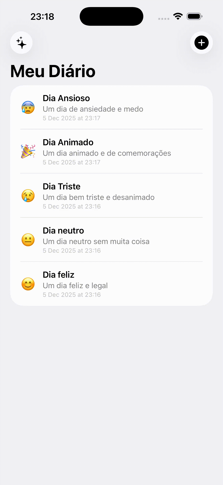
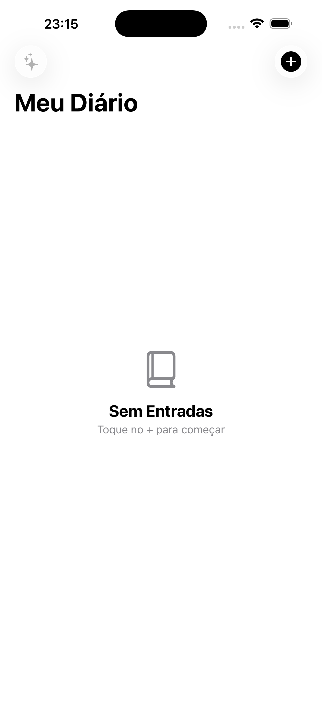
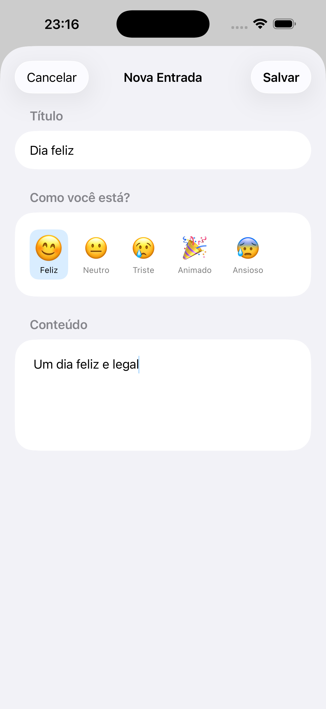
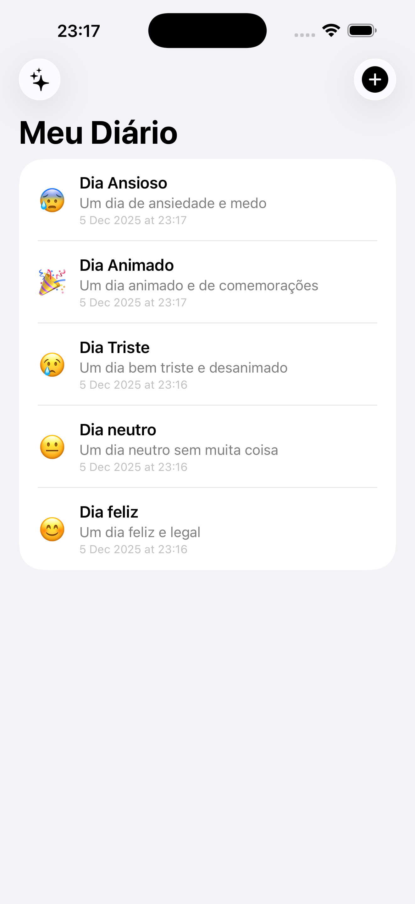
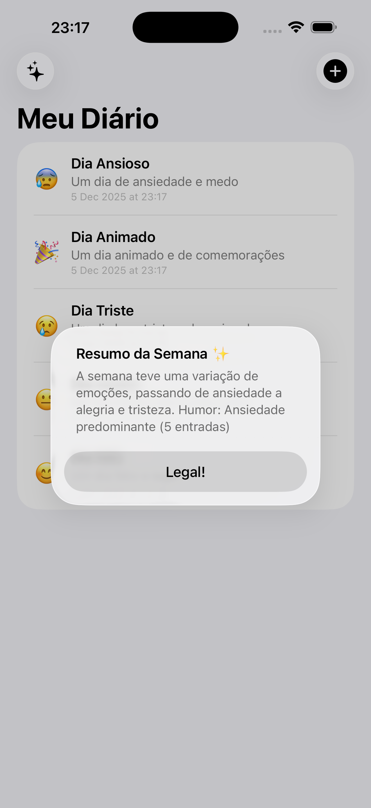

# Diário

[](https://developer.apple.com/ios/)
[](https://swift.org)
[](https://developer.apple.com/documentation/foundationmodels)
[](LICENSE)

A personal journal for iOS with an on-device AI weekly summary, Shortcuts support and playful animations.

<p align="center">
  
</p>

## Table of Contents

- [About](#about)
- [Features](#features)
- [Screenshots](#screenshots)
- [Built With](#built-with)
- [Getting Started](#getting-started)
- [Project Structure](#project-structure)
- [Author](#author)
- [License](#license)

## About

Diário is a small SwiftUI journal built to explore three recent Apple frameworks in
one app: **Foundation Models** for on-device text generation, **App Intents** for
Shortcuts and Siri, and SwiftUI's newer animation APIs. The UI is in Portuguese.

## Features

- Create, edit and delete entries with a title, text and mood
- Animated mood picker
- Weekly summary generated on device with Apple Intelligence
- Shortcuts actions to create an entry and read the latest one
- Confetti and toast feedback when an entry is saved

## Screenshots

| Empty state | New entry | Entries | AI summary |
| :---: | :---: | :---: | :---: |
|  |  |  |  |

## Built With

- SwiftUI with MVVM
- [Foundation Models](https://developer.apple.com/documentation/foundationmodels): `LanguageModelSession` with a `@Generable` `WeeklySummary` type for structured output
- [App Intents](https://developer.apple.com/documentation/appintents): `CreateDiaryEntryIntent` and `GetLastEntryIntent`
- Native animations: `.bouncy`, `.smooth`, `.snappy` and `symbolEffect`
- [ConfettiSwiftUI](https://github.com/simibac/ConfettiSwiftUI) (Swift Package)

## Getting Started

Requirements: Xcode 26 or later. The AI summary needs a device or simulator with
Apple Intelligence enabled; the rest of the app works without it.

```bash
git clone https://github.com/EnzoFerroni/Diario.git
cd Diario
open Diario.xcodeproj
```

Xcode resolves the ConfettiSwiftUI package on first build.

## Project Structure

```
Diario/
├── DiarioApp.swift
├── Models/        DiaryEntry, Mood
├── ViewModels/    DiaryViewModel
├── Views/         DiaryListView, DiaryEntryView, NewEntryView
├── Services/      AIService (Foundation Models)
└── Intents/       DiaryAppIntents (Shortcuts)
```

## Author

<div align="center">
  <table>
    <tr>
      <td align="center" width="100%">
        <a href="https://github.com/EnzoFerroni"></a>
        <br/><sub><b>Enzo Ferroni</b></sub><br/><br/>
        <a href="https://github.com/EnzoFerroni"></a>
        <a href="https://www.linkedin.com/in/enzoferroni/"></a>
      </td>
    </tr>
  </table>
</div>

## License

Released under the [MIT License](LICENSE). Copyright (c) 2025 Enzo Ferroni.
